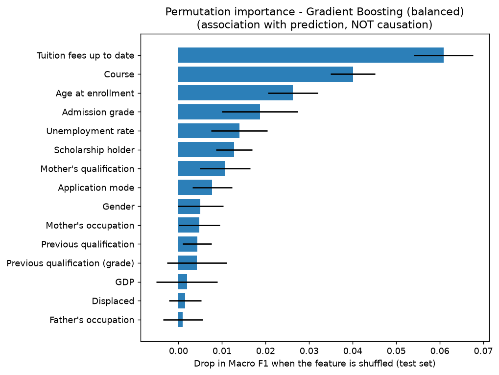

# Student Academic Outcome Prediction

**Gupio Campus Placement Drive - AI/ML Engineer - Option 1**

A machine-learning pipeline that predicts whether a student will end as **Dropout**, **Enrolled** or **Graduate**, using **only information available at enrollment**. The 12 first/second-semester performance columns are deliberately excluded to prevent data leakage.

> **Headline result (held-out test set, 885 students):** final model *Gradient Boosting (balanced)* reaches **Macro F1 = 0.547** (accuracy 0.580). The *Enrolled* class is predicted poorly (F1 0.36). Performance is moderate, and the model describes statistical associations only, not causes.

---

## 1. Dataset

| Item | Details |
|---|---|
| Source | UCI Machine Learning Repository - *Predict Students' Dropout and Academic Success* (ID 697) - <https://archive.ics.uci.edu/dataset/697/predict-students-dropout-and-academic-success> |
| DOI / licence | 10.24432/C5MC89 / CC BY 4.0 |
| File used | `data/data.csv` - the panel-supplied copy, **semicolon-delimited**, stored exactly as supplied (data rows and labels unaltered) |
| Size | 4,424 students x 37 columns (36 UCI features + `Target`) |
| Target classes | Graduate 2,209 (49.9%), Dropout 1,421 (32.1%), Enrolled 794 (17.9%) |
| Missing values / duplicates | 0 / 0 |
| Data types | 29 integer, 7 decimal, 1 text (`Target`) |

## 2. Technologies

Python 3, pandas, NumPy, scikit-learn (Pipeline, ColumnTransformer, models, metrics, permutation importance), Matplotlib, joblib, Jupyter notebook (VS Code), pytest (unit tests).

## 3. Project structure

```
student-outcome-prediction/
├── data/data.csv                 # supplied dataset (semicolon-delimited)
├── notebooks/eda_modeling.ipynb  # full workflow with explanations and saved outputs
├── src/
│   ├── config.py                 # seed, paths, column lists (single source of truth)
│   ├── data_loader.py            # load + inspect data
│   ├── eda.py                    # EDA charts
│   ├── preprocessing.py          # target/feature split, train/test split, ColumnTransformer + Pipeline
│   ├── models.py                 # the candidate models
│   ├── evaluate.py               # metrics, per-class tables, confusion-matrix plots
│   ├── train.py                  # cross-validation, final evaluation, selection, saving
│   ├── interpret.py              # permutation feature importance
│   ├── predict.py                # load saved model + predict (also a small CLI)
│   └── sensitivity.py            # side analysis without the two fee-status columns
├── tests/test_pipeline.py        # unit tests for the leakage rules
├── outputs/                      # result tables, run log and figures/ (generated)
├── models/                       # best_model.joblib + model_metadata.json (generated)
├── run_all.py                    # runs the whole workflow with one command
├── requirements.txt
├── .gitignore
└── README.md
```

## 4. Setup and run

Requires **Python 3.10 or newer**. Open the project folder in VS Code, open a terminal (**Terminal > New Terminal**) and run:

```bash
# 1) create and activate a virtual environment
python -m venv .venv
.venv\Scripts\activate            # Windows (PowerShell / CMD)
source .venv/bin/activate         # macOS / Linux

# 2) install dependencies
pip install -r requirements.txt

# 3) run the complete workflow (takes about one minute)
python run_all.py
```

`run_all.py` loads the data, builds the split, draws the EDA charts, cross-validates and compares the models, evaluates them on the test set, selects and saves the final model, computes feature importance, makes sample predictions and runs the sensitivity check. Everything it prints is also saved to `outputs/run_log.txt`; tables and charts go to `outputs/` and `outputs/figures/`.

**Other commands**

| Task | Command |
|---|---|
| Notebook | open `notebooks/eda_modeling.ipynb` in VS Code, select the `.venv` kernel, click **Run All** |
| Sample predictions with the saved model | `python -m src.predict` |
| Predict for your own file | `python -m src.predict --csv my_students.csv` (needs the 24 enrollment-time columns; any extra columns are ignored) |
| Unit tests | `python -m pytest tests -q` (or `python tests/test_pipeline.py`) |

Run all commands from the project root folder.

## 5. Completed workflow

1. Load and inspect the data (rows, columns, types, classes, missing values, duplicates).
2. Classify variables (numeric / binary / encoded-categorical) and note data-quality issues.
3. Separate the target, drop the 12 prohibited columns, make a stratified 80/20 train/test split.
4. EDA: target distribution and feature-vs-target charts using permitted predictors, drawn **from the training split only**.
5. Leakage-safe `ColumnTransformer` inside a `Pipeline`.
6. Compare 5 candidate models with 5-fold stratified cross-validation (training data only).
7. Evaluate every model once on the test set: Accuracy, Precision, Recall, F1, Macro F1, confusion matrix, per-class results.
8. Select one final model by the rule fixed in advance; save the whole pipeline.
9. Interpret with permutation importance; demonstrate predictions on sample students; run a sensitivity check; document limitations.

## 6. Preprocessing decisions

| Column group | Columns | Treatment |
|---|---|---|
| Numeric (7) | Application order, Previous qualification (grade), Admission grade, Age at enrollment, Unemployment rate, Inflation rate, GDP | median imputer -> `StandardScaler` |
| Binary 0/1 (8) | Daytime/evening attendance, Displaced, Educational special needs, Debtor, Tuition fees up to date, Gender, Scholarship holder, International | most-frequent imputer, otherwise unchanged |
| Encoded categorical (9) | Marital status, Application mode, Course, Previous qualification, Nacionality, Mother's / Father's qualification, Mother's / Father's occupation | most-frequent imputer -> `OneHotEncoder(handle_unknown="ignore")` |
| Prohibited (12) | all `Curricular units 1st sem (...)` and `2nd sem (...)` columns | **never selected** (checked by an `assert` and by unit tests) |

- Integer **codes** (course, occupation, ...) are one-hot encoded because their numeric size has no meaning. `Application order` is a 0-9 preference rank, so it is treated as numeric.
- There are no missing values, so the imputers do nothing on this dataset; they make the pipeline safe for new data and are fitted on training data only.
- No rows were removed and no values were altered. The only derived values are the one-hot columns and standardised numbers produced inside the pipeline. (The age bands used in one EDA chart are for plotting only and are not model features.)
- **Data-quality observations:** many code columns contain very rare codes (e.g. 32 of 46 father's-occupation codes have <10 students); 97.5% of students share one nationality code; ages range from 17 to 70 (median 20); `Nacionality` is misspelled in the original data (kept unchanged); the macro-economic columns have only 9-10 distinct values, so they behave like an enrollment-period label.

## 7. Train/test strategy

- **80% train (3,539) / 20% test (885)**, `train_test_split(..., stratify=y, random_state=42)`, so each class keeps the same share in both parts (Graduate 49.9%, Dropout 32.1%, Enrolled 17.9-18.0%).
- The test set is created **before** EDA and is not used for any choice. Feature-vs-target EDA uses the training split only.
- **Model selection** uses 5-fold stratified cross-validation **inside the training set**; the pipeline (including preprocessing) is re-fitted in every fold.
- After selection, each model is fitted on the full training set and scored **once** on the test set for reporting. Test scores were never used to choose or tune anything.
- Class imbalance is handled with `class_weight` **during training only** (no resampling, no threshold changes).
- Fixed seed `42` everywhere (`src/config.py`).

## 8. Prediction-time assumptions

- The prediction is made **at enrollment**. The 12 semester-performance columns do not exist yet at that point, so they are excluded.
- The model uses 24 enrollment-time columns, as the assignment instructs.
- **Caveat:** `Debtor` and `Tuition fees up to date` are permitted by the assignment, but fee status can change after enrollment. They are kept in the primary model and their effect is measured in Section 12.
- Macro-economic indicators are treated as known at enrollment.

## 9. Models compared

| Model | Settings | Purpose |
|---|---|---|
| Dummy (most frequent) | always predicts the majority class | floor / sanity check |
| Logistic Regression (no weights) | `max_iter=2000` | simple baseline |
| Logistic Regression (balanced) | + `class_weight="balanced"` | measures the effect of imbalance handling |
| Random Forest (balanced) | 300 trees, `min_samples_leaf=3`, `class_weight="balanced_subsample"` | tree ensemble |
| Gradient Boosting (balanced) | `HistGradientBoostingClassifier`, learning rate 0.05, 200 iterations, `max_depth=4`, `min_samples_leaf=20`, `class_weight="balanced"` | boosted trees |

No hyperparameter search was run; settings are sensible fixed values.

## 10. Results (actual output of `python run_all.py`, seed 42)

### 10.1 Cross-validation on the training set (used for selection)

| Model | CV Macro F1 (mean +/- std) | CV accuracy | CV balanced acc. |
|---|---|---|---|
| Dummy (most frequent) | 0.222 +/- 0.000 | 0.499 | 0.333 |
| Logistic Regression (no weights) | 0.552 +/- 0.015 | 0.650 | 0.549 |
| Logistic Regression (balanced) | 0.567 +/- 0.016 | 0.603 | 0.577 |
| Random Forest (balanced) | 0.573 +/- 0.023 | 0.635 | 0.572 |
| Gradient Boosting (balanced) | 0.582 +/- 0.009 | 0.620 | 0.590 |

### 10.2 Test set (885 students; each model scored once)

| Model | Accuracy | Balanced acc. | Macro Precision | Macro Recall | Macro F1 |
|---|---|---|---|---|---|
| Dummy (most frequent) | 0.499 | 0.333 | 0.166 | 0.333 | 0.222 |
| Logistic Regression (no weights) | 0.626 | 0.516 | 0.536 | 0.516 | 0.512 |
| Logistic Regression (balanced) | 0.573 | 0.563 | 0.563 | 0.563 | 0.550 |
| Random Forest (balanced) | 0.606 | 0.546 | 0.544 | 0.546 | 0.545 |
| Gradient Boosting (balanced) | 0.580 | 0.555 | 0.558 | 0.555 | 0.547 |

### 10.3 Per-class Precision / Recall / F1 (test set)

| Model | Dropout P / R / F1 | Enrolled P / R / F1 | Graduate P / R / F1 |
|---|---|---|---|
| Dummy (most frequent) | 0.00 / 0.00 / 0.00 | 0.00 / 0.00 / 0.00 | 0.50 / 1.00 / 0.67 |
| Logistic Regression (no weights) | 0.66 / 0.59 / 0.62 | 0.29 / 0.13 / 0.18 | 0.65 / 0.83 / 0.73 |
| Logistic Regression (balanced) | 0.69 / 0.58 / 0.63 | 0.30 / 0.52 / 0.38 | 0.70 / 0.59 / 0.64 |
| Random Forest (balanced) | 0.60 / 0.64 / 0.62 | 0.32 / 0.31 / 0.31 | 0.71 / 0.69 / 0.70 |
| Gradient Boosting (balanced) | 0.66 / 0.57 / 0.61 | 0.29 / 0.47 / 0.36 | 0.72 / 0.63 / 0.67 |

Class sizes in the test set: Dropout 284, Enrolled 159, Graduate 442. Full tables: `outputs/per_class_metrics_test.csv`, `outputs/classification_reports.txt`; confusion-matrix figures for every model: `outputs/figures/cm_*.png`.

### 10.4 Final model in detail - Gradient Boosting (balanced)

| Class | precision | recall | f1-score | support |
|---|---|---|---|---|
| Dropout | 0.663 | 0.567 | 0.611 | 284 |
| Enrolled | 0.290 | 0.472 | 0.359 | 159 |
| Graduate | 0.723 | 0.627 | 0.672 | 442 |

Confusion matrix (rows = true class, columns = predicted class):

| True class \ Predicted | pred Dropout | pred Enrolled | pred Graduate |
|---|---|---|---|
| true Dropout | 161 | 70 | 53 |
| true Enrolled | 31 | 75 | 53 |
| true Graduate | 51 | 114 | 277 |

### 10.5 Class imbalance: what works and what does not

- The classes are imbalanced (Enrolled is the smallest at 17.9%). Always predicting "Graduate" gives about 50% accuracy but a Macro F1 of only 0.222.
- Plain Logistic Regression has the **highest accuracy (0.626)** but finds only **13.2%** of Enrolled students; it leans on the big Graduate class (recall 82.8%).
- With `class_weight="balanced"`, Enrolled recall rises to 52.2% and Macro F1 from 0.512 to 0.550, at the price of lower accuracy (0.573). This is why accuracy alone is not used for selection.
- **Handled well:** *Graduate* (F1 0.67 for the final model) and, moderately, *Dropout* (F1 0.61).
- **Handled poorly:** *Enrolled* (F1 0.36; precision only 0.29). Many students predicted "Enrolled" are not, and about half of true Enrolled students are missed. This is plausibly because "still enrolled" sits between the other two outcomes and enrollment-time information says little about it (an interpretation, not something tested here).

## 11. Final model choice

**Selected: Gradient Boosting (balanced).**

- **Rule (fixed before looking at test scores):** highest mean cross-validated **Macro F1** on the training set. Gradient Boosting (balanced) scored **0.582**, ahead of Random Forest (0.573) and balanced Logistic Regression (0.567); it also had the smallest fold-to-fold spread (+/- 0.009) and the best CV balanced accuracy (0.590).
- On the unseen test set it achieved Macro F1 **0.547** and recovers 47.2% of Enrolled students and 56.7% of Dropouts.
- It was **not** chosen for accuracy: its accuracy (0.580) is lower than plain Logistic Regression (0.626), but it treats the minority class far better.
- **Honest caveat:** on the test set the three class-weighted models are essentially tied on Macro F1 (Logistic Regression 0.550, Gradient Boosting (balanced) 0.547, Random Forest 0.545). With 885 test students, differences of about 0.005 are within noise. The choice was **not** changed after seeing the test scores, because that would turn the test set into a selection tool.

## 12. Interpretation, sample predictions and sensitivity

### Feature importance (permutation importance on the test set, final model)

| Feature | Macro-F1 drop when shuffled | Std |
|---|---|---|
| Tuition fees up to date | 0.0647 | 0.0061 |
| Course | 0.0333 | 0.0080 |
| Age at enrollment | 0.0221 | 0.0068 |
| Unemployment rate | 0.0135 | 0.0043 |
| Admission grade | 0.0083 | 0.0101 |
| Mother's qualification | 0.0058 | 0.0047 |
| Scholarship holder | 0.0057 | 0.0046 |
| Previous qualification | 0.0043 | 0.0051 |



- Fee status, course and age matter most to the model, in line with the EDA (e.g. dropout is 86.9% among students whose fees are not up to date vs 24.8% when they are, in the training data; dropout is 20.7% for students aged <=19 but 57.8% for 25-29 and 54.2% for 30+).
- `Unemployment rate` has only 10 distinct values, so it probably lets the model recognise the enrollment **cohort**, not an individual trait.
- Bars with wide error bars (e.g. Admission grade) are not reliably ranked.
- **Model importance does not prove causation.** The model shows what it *uses* to predict, not what would change a student's outcome. For instance, unpaid fees may be a symptom of a student already disengaging.

### Sample predictions (`python -m src.predict`; produced by the saved model file)

Six unseen test students (two per true class) and two made-up students built from the typical training profile. They go through exactly the same saved pipeline as the training data.

| Student | actual_outcome | predicted_outcome | P(Dropout) | P(Enrolled) | P(Graduate) | correct |
|---|---|---|---|---|---|---|
| row 4055 (test) | Dropout | Dropout | 0.553 | 0.306 | 0.141 | yes |
| row 3003 (test) | Dropout | Graduate | 0.108 | 0.271 | 0.621 | NO |
| row 3653 (test) | Enrolled | Enrolled | 0.170 | 0.497 | 0.334 | yes |
| row 186 (test) | Enrolled | Dropout | 0.821 | 0.140 | 0.039 | NO |
| row 2271 (test) | Graduate | Graduate | 0.174 | 0.232 | 0.594 | yes |
| row 168 (test) | Graduate | Dropout | 0.543 | 0.184 | 0.272 | NO |
| Hypothetical A (typical) | (unknown - made up) | Graduate | 0.101 | 0.383 | 0.517 | n/a |
| Hypothetical B (debt, fees overdue, age 30) | (unknown - made up) | Dropout | 0.963 | 0.032 | 0.005 | n/a |

Three of the six real students are classified correctly. The three misses are a Dropout predicted as Graduate, an Enrolled student predicted as Dropout (with probability 0.82) and a Graduate predicted as Dropout. Six students are only an illustration, not a performance estimate (see Section 10 for that). The two hypothetical students only show that the model accepts new records; they are **not** evidence about what would change an outcome.

### Sensitivity check: without `Debtor` and `Tuition fees up to date`

| setting | CV Macro F1 | Test Macro F1 | Test accuracy |
|---|---|---|---|
| Primary (all 24 features) | 0.5820 | 0.5471 | 0.5797 |
| Without Debtor, Tuition fees up to date (22 features) | 0.5291 | 0.5333 | 0.5672 |

The model depends noticeably on the fee columns. If fee status is actually recorded after enrollment, realistic enrollment-only performance is closer to the lower figure (it is still well above the dummy baseline's Macro F1 of 0.222). This side analysis does not change the primary model.

## 13. Assumptions

- The supplied `data.csv` is the dataset of record; labels are taken as correct.
- Columns not on the prohibited list are available at enrollment (see the fee-status caveat above).
- Categorical columns are integer codes without ordering; their meaning (e.g. which code is which course) is not decoded.
- Macro Precision/Recall/F1 are unweighted averages over the three classes.
- Macro F1 on the cross-validated training set is the selection criterion.

## 14. Limitations

- **Prediction is not causation.** Results are statistical associations in historical data; they do not explain why students drop out or what interventions would help.
- **Moderate accuracy.** Test Macro F1 is about 0.55; the Enrolled class is poorly predicted. Individual decisions about students should not rely on this model without human review.
- **Uncertainty:** one 885-student test set and a single split; cross-validation spread is about +/-0.01 to +/-0.02 Macro F1.
- **Possible timing leakage** in the fee-status columns (Section 12).
- **Cohort proxy** via the macro-economic columns: the model may not transfer to other years or institutions.
- **Rare codes** are noisy; unseen codes are ignored at prediction time.
- **Single institution**; no fairness audit across groups (e.g. gender, nationality, age) was performed. Age, gender and nationality are used as predictors and could encode bias.
- No hyperparameter tuning or probability calibration.
- Exact numbers can differ slightly with different library versions or operating systems (tested with Python 3.12, scikit-learn 1.8, pandas 3.0, NumPy 2.4, Matplotlib 3.10).

## 15. Completed and incomplete features

**Completed**

- [x] Data loading/inspection, variable typing, data-quality notes
- [x] EDA: target distribution + feature-vs-target charts (training data only)
- [x] Leakage-safe preprocessing (ColumnTransformer inside Pipeline; prohibited columns excluded)
- [x] Stratified train/test split with fixed seed; test set untouched during selection
- [x] 5 models compared (Dummy, 2x Logistic Regression, Random Forest, Gradient Boosting)
- [x] Accuracy, Precision, Recall, F1, Macro F1, confusion matrix, per-class results for every model
- [x] Class-imbalance discussion; final-model choice with justification
- [x] Sample predictions using the saved pipeline; feature importance; limitations
- [x] Bonus: 5-fold cross-validation, permutation importance (explainability), unit tests, sensitivity analysis

**Not done / incomplete**

- [ ] Systematic hyperparameter tuning
- [ ] SHAP explanations
- [ ] Probability calibration, threshold tuning, resampling (e.g. SMOTE)
- [ ] Fairness audit
- [ ] Inference API / interactive demo / Docker

## 16. Verification record

Checks performed on the project as delivered:

- `python run_all.py` runs from start to finish without errors (about one minute on a single CPU core), loads `data/data.csv`, trains all models and writes all results.
- Running it again (and running the notebook) reproduces **identical** result tables (same seed).
- `python tests/test_pipeline.py`: 10/10 tests pass (no prohibited columns, split is disjoint/stratified/reproducible, scaler statistics come from training data only and are unchanged by `transform`, unseen category codes do not crash, prediction ignores extra columns).
- Prediction uses the **same saved Pipeline object** as training (`models/best_model.joblib`), so preprocessing cannot differ.
- The README numbers were generated from the files in `outputs/`.
- The repository contains no passwords, API keys or `.env` files.

> **Re-verified locally by:** `<YOUR NAME>` on `<OS / Python version>` on `<DATE>` - *edit this line after you run the project on your own machine.*

## 17. AI usage note

An AI chat assistant (Claude) was used as a coding/reference assistant. No autonomous coding agent (Claude Code, Cursor Agent, etc.) was used. The author has read and can explain every file in this repository.

## 18. Citation

Realinho, V., Vieira Martins, M., Machado, J., & Baptista, L. (2021). *Predict Students' Dropout and Academic Success* [Dataset]. UCI Machine Learning Repository. https://doi.org/10.24432/C5MC89 (CC BY 4.0)
